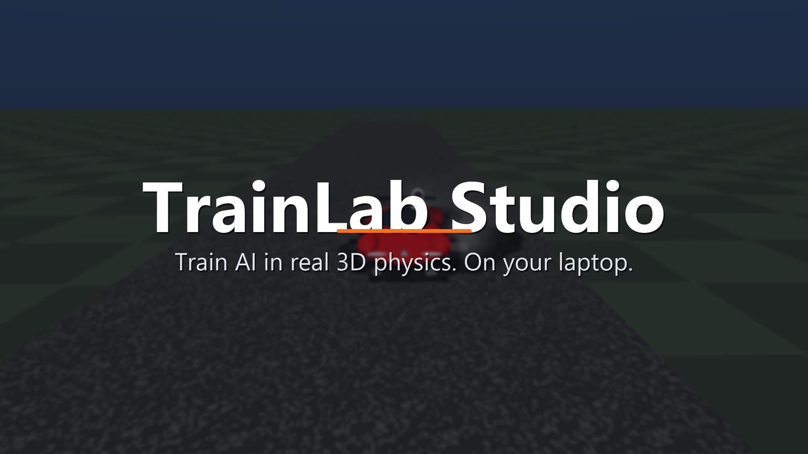

# TrainLab

**Train reinforcement-learning agents on any 3D simulation, or just describe one in plain English.**

[](brag-output/brag.mp4)

▶️ *Click the image to watch the 23-second launch video* ([brag-output/brag.mp4](brag-output/brag.mp4)).
Every shot in it is real TrainLab output: real physics crashes, the trained sample parking, and the Studio UI.

TrainLab takes the classic *Lunar Lander* idea: an agent learns a hard control task from a
shaped reward. It moves that into full 3D physics (MuJoCo), makes it general (any scenario
is one Python file plus one XML model), and adds a web Studio where you type an idea. The AI model
of your choice (Claude, GPT, Gemini, a free local model, ...) then builds the world and the reward, TrainLab checks it, trains an agent on it, and shows
you a video of the result.

The first scenario pack is a **Roadster-style electric sports car with a cold-gas thruster
pack** and Starman in the passenger seat.

> Fan project for learning. It has no connection to Tesla or SpaceX. Car dimensions and
> thruster numbers are rough approximations.

| Scenario | The agent must... | Controls |
|---|---|---|
| `roadster_gap_jump` | accelerate, fire thrusters over a pit, land on a raised ledge, and park in the green box | throttle, steer, brake, lift, pitch, roll, yaw |
| `roadster_launch_sprint` | launch hard and stop exactly on the line (road grip is random) | throttle, steer, brake |
| `roadster_track_race` | lap a floating 3D track with hills and banked turns (a new track every episode) | throttle, steer, brake |
| `roadster_space_dock` | dock with a space station in zero gravity using thrusters only | 6-DoF thrusters |

Every scenario has a **difficulty curriculum**: wider gaps, higher ledges, stronger wind
gusts and so on. The agent moves up a level automatically once its success rate passes 80%.

---

## Install (Windows, CPU only is fine)

```bash
cd "D:\MY works\TrainLab"
py -3.11 -m pip install -e ".[studio,dev]"
```

> On this PC, plain `python` points at a different virtual environment, so use
> `py -3.11` or the full path `C:\Users\JESUS\AppData\Local\Programs\Python\Python311\python.exe`.
> If `trainlab` isn't found after installing, run `py -3.11 -m trainlab.cli ...` instead.

## Use it

```bash
trainlab list                                   # see all scenarios
trainlab play roadster_gap_jump                 # drive it yourself (W/S throttle, A/D steer, SPACE lift, I/K pitch...)
trainlab train roadster_gap_jump --steps 3e6    # train PPO with the curriculum
trainlab watch runs/roadster_gap_jump/<run>     # watch the agent in the 3D viewer
trainlab record runs/roadster_gap_jump/<run> --out jump.gif   # GIF/MP4 for LinkedIn or your resume
trainlab compare roadster_gap_jump --algos ppo sac dqn --seeds 3 --steps 1e6
tensorboard --logdir runs                       # live training curves
```

Your keyboard scores are saved to `runs/<scenario>/human_scores.csv`, so you can compare yourself with the AI.

### Start with the sample: the Roadster

The Roadster GapJump is TrainLab's built-in sample and the default for every command. It
needs no API key:

```bash
trainlab train          # = trainlab train roadster_gap_jump
trainlab play           # drive the sample yourself
```

In Studio, click **Train the sample Roadster** at the top.

### Studio: type an idea, get a trained agent

```bash
cp .env.example .env        # paste the API key of ANY provider you use (only one is needed)
trainlab studio             # opens http://localhost:7860
```

**Bring your own AI model.** Pick the provider in **Settings**, paste its key, then click
**Load models** to see the models your account can use.

| Provider | Key | Notes |
|---|---|---|
| Anthropic (Claude) | `ANTHROPIC_API_KEY` | |
| OpenAI (GPT) | `OPENAI_API_KEY` | |
| Google Gemini | `GEMINI_API_KEY` | free tier at aistudio.google.com |
| Groq | `GROQ_API_KEY` | free tier |
| OpenRouter | `OPENROUTER_API_KEY` | one key for hundreds of models; some are free |
| DeepSeek, Mistral | `DEEPSEEK_API_KEY`, `MISTRAL_API_KEY` | |
| **Ollama** | none | **free**, runs on your own PC |
| Custom | `CUSTOM_LLM_BASE_URL` (+ key if needed) | any OpenAI-compatible server (LM Studio, vLLM, ...) |

A chat subscription (ChatGPT Plus, Claude Pro, Gemini Advanced) is **not** an API key.
Keys come from each provider's developer console. Small local models can need extra
repair rounds; bigger models get it right more often. From the terminal:
`trainlab generate "<idea>" --provider gemini --model <id>`.

1. **Create.** Describe the world, for example *"a drone landing on a pitching ship deck in gusty wind"*.
2. **Review.** See a preview, the controls and the reward design in plain English, and the
   generated code (which you can edit). Ask for changes ("make the wind stronger").
3. **Train.** Pick an algorithm and a step budget.

   **🔴 Live 3D** shows the agent learning in real time: the current policy drives non-stop
   in a spare copy of the world, refreshed about twice a second, at roughly 5–10% of
   training speed. Tick *interactive 3D window* (or run `trainlab train --view`) for MuJoCo's
   3D viewer, where you can rotate and zoom with the mouse; that window uses more CPU. If the
   laptop runs low on memory, the panel says so and training pauses safely.

   Below it, the **trial-and-error panel** shows
   the agent's actual 3D attempts as it learns:
   - every ~25k steps, the still-learning agent plays one attempt;
   - each attempt is stamped ✅ WON or ❌ FAILED (fell, flipped, body hit, time up, ...);
   - a gallery of every attempt so far, a tally of how all training episodes ended, and the win rate over time.

   **Watch live** follows runs started from the terminal too. The clips are saved in `runs/<run>/live/`.
4. **Results.** Record a clip and download the trained model.

Keys pasted in **Settings** are kept for that browser session only unless you tick
*save to .env*.

**How generation stays safe and working:**
- The model returns structured JSON (the model XML, the scenario code, the config and the reward explanation).
- TrainLab statically checks the code against an allowlist: no `os`, files, network,
  `eval` or dunder tricks. It then runs Gymnasium's env checker and a random rollout
  **in a separate process with a timeout**.
- Any error goes back to the model for up to 3 automatic repair rounds.
- Nothing becomes a real scenario until you click **Accept**. Always read the code first:
  the checks are guard rails, not a hardened sandbox.

Optional realistic visuals: `trainlab/generator/mesh_provider.py` is a placeholder where you
can plug in a text-to-3D service (key: `TEXT_TO_3D_API_KEY`). Physics always uses simple
collision shapes, so training stays fast.

---

## How the reward works (the Lunar Lander trick, in 3D)

GapJump's reward, every step (20 Hz):

| Term | Value | Why |
|---|---|---|
| shaping | Φ(now) − Φ(before), with Φ = −100·dist/start_dist − 20·tilt − 2·(speed over braking envelope) | Dense feedback toward the parking box. Because it's *potential-based*, the agent can't farm it. |
| lift fuel | −0.3 × lift | Thrusters are expensive, so it uses them only when needed |
| attitude fuel | −0.03 × (‖pitch‖+‖roll‖+‖yaw‖) | Small cost for steering with thrusters |
| time | −0.03 | Don't dawdle |
| parked | +100 + 30 × fuel left | Stopped, upright, in the box |
| crash | −100 (episode ends) | Fell, flipped, body hit, or hard landing (> 8 m/s down) |

Per-term values are in `info["reward_terms"]`, so you can debug what the agent is optimising.

## Make your own scenario

```bash
trainlab new my_robot      # -> trainlab/scenarios/generated/my_robot/{scenario.py, model.xml, config.yaml}
```

Implement four hooks in `scenario.py`: `randomize`, `get_obs`, `check_done` and
`compute_reward`. Edit the world in `model.xml`. Every command (`play`, `train`, `compare`,
`record`, Studio) then works on it.

## Project layout

```
trainlab/
  core/        base_env (MuJoCo + Gymnasium), registry, rewards, wind, curriculum, wrappers
  scenarios/   Roadster pack + _roadster.py (shared car) + generated/ (yours)
  assets/      roadster.xml (car model), template_model.xml
  agents/      train.py, runner.py, compare.py
  play/        keyboard.py (pygame)
  generator/   llm_client, prompts, validate, check_scenario, pipeline, scaffold, mesh_provider
  studio/      app.py (Gradio)
  configs/     default.yaml + per-scenario hyperparameters
tests/         pytest: env checker, determinism, physics sanity, validator safety
```

## 8 GB laptops: safe by default

TrainLab reads your RAM and picks gentle settings automatically. Run `trainlab status` to see them.

- **8 GB:** 2 parallel simulations, 2 CPU threads, and below-normal process priority, so your browser and typing stay smooth.
- **Low memory:** if free RAM drops under 0.2 GB, training saves and **pauses** instead of freezing Windows. It carries on when memory frees up, or stops cleanly after 10 minutes.
- **Shutting down mid-training:** progress is autosaved every 20k steps. After you turn the laptop back on, run:

  ```bash
  trainlab status     # shows unfinished runs
  trainlab resume     # continues the most recent one from its last autosave
  ```

  Studio has a **Resume unfinished run** button for the same thing.
- **Local AI models (Ollama):** an 8B model like gemma4 needs about 7 GB with TrainLab's context size, so on 8 GB it swaps and takes minutes per answer. Studio warns you about this. Use a 3–4B model or a free Gemini/Groq key instead.

## Realistic expectations (laptop CPU, no GPU)

- About 800–1,000 environment steps per second with 4–6 parallel environments.
- GapJump level 0 (small gap, flat): a few hundred thousand to about 1M steps.
- The full curriculum takes millions of steps (hours). Start small, record a clip, then let it run overnight.
- TrackRace is the hardest: expect several million steps before clean laps.

## What to add next

- **Recurrent PPO (LSTM)** from `sb3-contrib`, so the agent can infer wind it can't observe.
- **Imitation learning**: record your keyboard runs and pre-train on them (behaviour cloning).
- **Pixel-based training** from the chase camera, if you get a GPU.
- **Push models to the Hugging Face Hub** with a video, for a portfolio link.
- **Weights & Biases** experiment tracking.
- **More scenario packs**: drone delivery, Mars rover, reusable-booster landing, all one prompt away in Studio.
